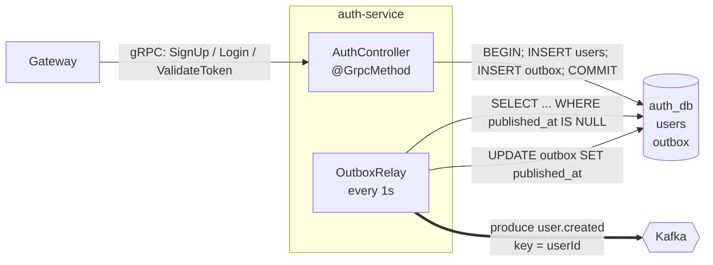
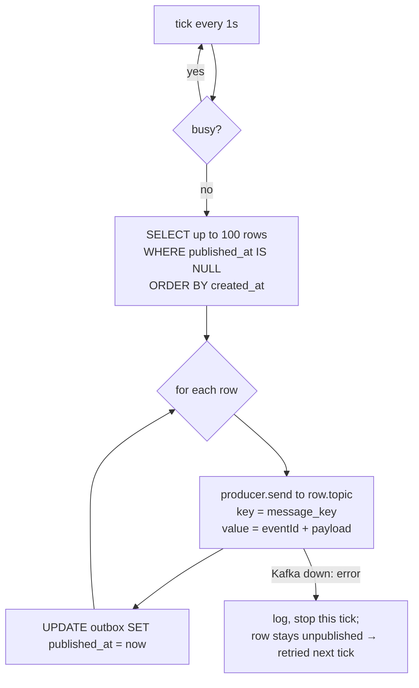

# auth-service

> Folder: `services/auth/src/` · gRPC on **:50051** · DB **auth_db** (Postgres :5433) · Kafka **producer** of `user.created`

## 1. What it is

The service that knows **who you are**. It creates accounts, checks passwords and issues/validates **JWT tokens**. It's the **source of truth for users**.



It has **two doors**:
- **In:** gRPC server. Only the gateway calls it.
- **Out:** Kafka producer (through the outbox). It announces new users; it never calls other services.

## 2. Database: `auth_db`

```sql
users  (id UUID PK, name, email UNIQUE, password_hash, created_at)
outbox (id UUID PK, topic, message_key, payload JSONB, created_at, published_at NULL = not sent yet)
idempotency_keys (key TEXT PK, user_id → users.id, created_at)
```
- `email UNIQUE`: the **database** enforces "one account per email". Even two simultaneous signups can't both win.
- `password_hash` = `salt:hash`. The plain password is never stored.
- `outbox`: events waiting to go to Kafka. `published_at IS NULL` means "still to send".

## 3. The gRPC methods

### `SignUp(SignUpRequest) → AuthResponse`
**Input:** `{ name, email, password, idempotency_key }` (the key is optional)
**What it does:**
1. Validates: name not empty, email contains `@`, password ≥ 6. Fails → `INVALID_ARGUMENT`.
2. Lower-cases the email (`Riya@Mail.com` = `riya@mail.com`).
2b. **Idempotency check:** if this `idempotency_key` already created a user (same email, correct password), it returns **that** user with a fresh token and does nothing else. A key reused for a different request → `INVALID_ARGUMENT`. Details: [idempotency-and-backpressure.md](idempotency-and-backpressure.md#4-the-idempotency-key-how--works).
3. Generates `userId = crypto.randomUUID()`.
4. Hashes the password: `scrypt(password, randomSalt, 64)`. scrypt is deliberately slow and memory-hungry, so brute force is expensive. It's built into Node, no library needed.
5. **One transaction:**
   ```sql
   BEGIN;
   INSERT INTO users  (...)  VALUES (userId, 'Riya', 'riya@mail.com', 'salt:hash');
   INSERT INTO outbox (...)  VALUES (eventId, 'user.created', userId, '{"userId":..,"name":..,"email":..}');
   INSERT INTO idempotency_keys (key, user_id) VALUES (K, userId);   -- only if a key was sent
   COMMIT;
   ```
   Duplicate email → Postgres error `23505` → `ROLLBACK` → if it was a parallel retry with the same key, return the winner's result; otherwise `ALREADY_EXISTS`.
6. Signs a JWT `{ sub: userId, email }` valid 1 h.

**Returns:** `{ user_id, token }`
**Errors:** `INVALID_ARGUMENT`, `ALREADY_EXISTS`

### `Login(LoginRequest) → AuthResponse`
**Input:** `{ email, password }`
1. `SELECT` user by email.
2. Re-hash the given password with the **stored salt**; compare with `timingSafeEqual` (constant time, so response time doesn't leak how many characters matched).
3. Same error for "no such email" and "wrong password" → nobody can probe which emails exist.

**Returns:** `{ user_id, token }` · **Errors:** `UNAUTHENTICATED`
No event is published: logging in changes no shared state.

### `ValidateToken(ValidateTokenRequest) → ValidateTokenResponse`
**Input:** `{ token }`
`jwt.verify(token, secret)` checks the signature and expiry.
**Returns:** `{ valid: true, user_id, email }` or `{ valid: false }`. It never throws: "invalid" is a normal answer, not an error.
**Called by:** the gateway's `AuthGuard` on **every protected request**.

## 4. The Outbox Relay (`outbox-relay.ts`)

A timer inside the service, every 1 second:



The relay connects to Kafka **lazily** inside the tick. If Kafka is down when auth starts, auth still boots and `SignUp` still works; the relay just keeps retrying. (Verified: with Kafka stopped, a signup's outbox row sat with `published_at = NULL` and went out ~6 s after Kafka restarted.)

What ends up in Kafka:
```json
topic: user.created   key: 7f3c…(userId)
{ "eventId": "e1a9…", "occurredAt": "2026-10-20T10:00:00Z", "userId": "7f3c…", "name": "Riya", "email": "riya@mail.com" }
```

- **Key = userId** → all events of one user go to the same partition → stay in order.
- **eventId** (= outbox row id) lets consumers spot duplicates.
- If the process dies **after** `send` but **before** `UPDATE`, the row is sent again on restart. That's **at-least-once** delivery, so consumers must be idempotent (profile-service is).

Limitation, marked in the code: with several auth instances, two relays could grab the same rows. Fix with `SELECT … FOR UPDATE SKIP LOCKED`, or replace polling with **CDC** (Debezium reading Postgres' WAL).

## 5. Why does auth publish an event instead of calling profile?

| Call profile.CreateProfile via gRPC | Publish `user.created` to Kafka ✅ |
|---|---|
| Signup fails if profile is down | Signup always works; profile catches up |
| Auth must know every service that cares about new users | Auth knows nobody; anyone can subscribe |
| Signup waits for profile | Signup returns immediately |
| Strongly consistent | Eventually consistent (≈1 s delay) |

## 6. Failure scenarios

| Situation | Result |
|---|---|
| Kafka down | SignUp still succeeds; events pile up in `outbox`; published when Kafka returns |
| auth_db down | SignUp/Login fail (gRPC `UNKNOWN` → 500). Auth can't work without its own data |
| auth-service down | Gateway gets `UNAVAILABLE` → 503 for signup/login **and every protected route** (token checks) |
| Same email twice at the same moment | DB `UNIQUE` lets exactly one win; the other gets 409 |

## 7. Security notes
- Passwords: scrypt + per-user random salt; constant-time compare.
- `JWT_SECRET` comes from env; the default `dev-secret-change-me` is for local use only.
- gRPC runs **plaintext** locally. In production use TLS/mTLS between services.

## 8. Files
| File | What |
|---|---|
| `main.ts` | starts the gRPC server on 50051 with `auth.proto` |
| `app.module.ts` | registers controller, Db, OutboxRelay |
| `auth.controller.ts` | `SignUp`, `Login`, `ValidateToken` + password/JWT helpers |
| `db.ts` | Postgres pool, creates `users` + `outbox` tables on boot |
| `outbox-relay.ts` | outbox → Kafka publisher |
