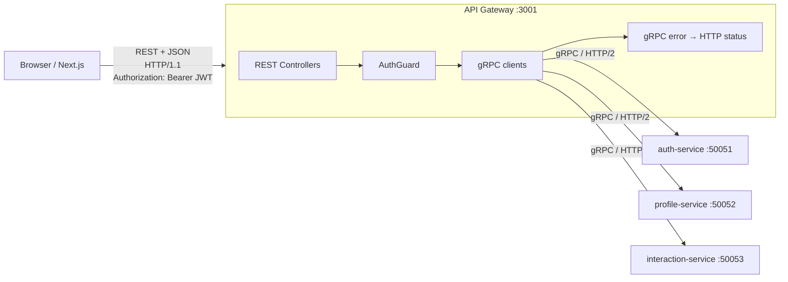
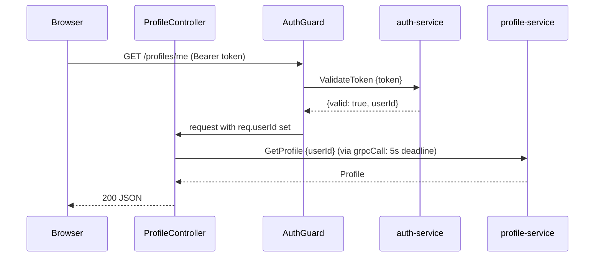

# API Gateway

> Folder: `gateway/src/` · Port **3001** · NestJS (HTTP) · Speaks **REST in, gRPC out** · Owns **no database**

## 1. What it is

The **only** server the browser knows about. It's the front door of the system.



## 2. What it serves (its jobs)

| Job | Where | Why |
|---|---|---|
| **One public entry point** | `main.ts` (`listen(3001)`) | The browser only needs one URL; services stay private |
| **Protocol translation** | every controller | Browsers speak REST/JSON; services speak gRPC/Protobuf |
| **Rate limiting** | `rate-limit.guard.ts` (global) | Over 50 req / 10 s per IP → `429` + `Retry-After`, before any gRPC call. See [idempotency-and-backpressure.md](idempotency-and-backpressure.md#part-2-50000-requests-capacity-30000) |
| **Idempotency key pass-through** | `auth.controller.ts` | `Idempotency-Key` header → `idempotency_key` field of `SignUp` |
| **Authentication** | `auth.guard.ts` | Checks the JWT once at the edge, so services can trust `userId` |
| **Routing** | `*.controller.ts` | `/auth/*` → auth, `/profiles/*` → profile, `/interactions/*` → interaction |
| **Deadlines** | `grpc-call.ts` | No request hangs forever: 5 s max per gRPC call |
| **Error translation** | `grpc-call.ts` | gRPC `NOT_FOUND` → HTTP 404, etc. |
| **CORS** | `main.ts` | Lets `localhost:3000` call `localhost:3001` |

What it **doesn't** do: business logic, or touching databases. It's a thin translator.

## 3. How it serves: one request end to end

`GET /profiles/me` with header `Authorization: Bearer eyJhbGc...`



1. **Nest routing** matches `GET /profiles/me` to `ProfileController.me()`.
1b. The global **`RateLimitGuard`** counts the request for this IP; over the limit → **429**, and nothing else runs.
2. `@UseGuards(AuthGuard)` runs next:
   - no header → **401 "missing token"**
   - calls `AuthService.ValidateToken` over gRPC
   - `valid: false` → **401 "invalid or expired token"**
   - else sets `req.userId` (from the token, **never** from the body or URL)
3. The controller calls `this.profiles.getProfile({ userId: req.userId })`. That returns an RxJS **Observable** (Nest's gRPC client API).
4. `grpcCall()` converts it to a Promise, adds a **5 s timeout**, and maps errors.
5. Nest serializes the returned object to JSON.

## 4. The REST API it exposes

| Method + path | Body | Guard | Calls | Returns |
|---|---|---|---|---|
| `POST /auth/signup` (+ optional `Idempotency-Key` header) | `{name, email, password}` | no | `AuthService.SignUp` | `201 {userId, token}` |
| `POST /auth/login` | `{email, password}` | no | `AuthService.Login` | `200 {userId, token}` |
| `GET /profiles` | none | yes | `ProfileService.ListProfiles` | `200 Profile[]` |
| `GET /profiles/me` | none | yes | `ProfileService.GetProfile` | `200 Profile` |
| `PATCH /profiles/me` | `{bio}` | yes | `ProfileService.UpdateProfile` | `200 Profile` |
| `POST /interactions/follow/:userId` | none | yes | `InteractionService.Follow` | `201 {success, message}` |
| `GET /interactions/following` | none | yes | `InteractionService.GetFollowing` | `200 {followeeIds}` |

## 5. Error translation (`grpc-call.ts`)

gRPC has its own status codes. The browser understands HTTP ones:

| gRPC status | thrown when | → HTTP |
|---|---|---|
| `INVALID_ARGUMENT` (3) | bad input (short password, self-follow) | 400 |
| `UNAUTHENTICATED` (16) | wrong login | 401 |
| `NOT_FOUND` (5) | profile/user doesn't exist | 404 |
| `ALREADY_EXISTS` (6) | email taken | 409 |
| `RESOURCE_EXHAUSTED` (8) | a service is overloaded | 429 |
| *(gateway's own rate limit)* | too many requests from one IP | 429 |
| `UNAVAILABLE` (14) | service down / unreachable | 503 |
| `DEADLINE_EXCEEDED` (4) / our 5 s timeout | service too slow | 504 |
| anything else | bug | 500 |

The error **message** comes from the gRPC `details` field, which the service set with `new RpcException({ code, message })`.

## 6. gRPC connections (`grpc-clients.ts`)

```ts
ClientsModule.register([
  grpcClient(AUTH,        'auth',        'auth.proto',        'localhost:50051'),
  grpcClient(PROFILE,     'profile',     'profile.proto',     'localhost:50052'),
  grpcClient(INTERACTION, 'interaction', 'interaction.proto', 'localhost:50053'),
]);
```
- Each entry = one gRPC **channel** = one long-lived **HTTP/2 connection**, opened on first use and **reused** for every request (no TCP/TLS handshake per call).
- HTTP/2 **multiplexing**: 100 users hitting the gateway at once → 100 parallel streams on that **one** connection.
- URLs come from env vars (`AUTH_GRPC_URL` …), so in Docker/K8s they'd be `auth-service:50051`.

## 7. Design decisions you may be asked about

**Why validate the token by calling auth every time?**
Simple and always correct: auth is the only one holding the JWT secret, and it could also check revocation. Cost: one extra gRPC hop per request.
*Alternative:* the gateway verifies the JWT **locally** (shared secret, or auth's public key with RS256/JWKS). Faster, no dependency on auth for every request, but revoking a token is harder.

**Why not let the browser call services directly?**
Then every service needs CORS, auth checks and a public port, and the browser can't speak gRPC anyway. The gateway centralizes all of that.

**Isn't the gateway a single point of failure?**
It's stateless, so you run several copies behind a load balancer.

**Backend-for-Frontend (BFF)?**
This gateway is effectively a BFF for the web app. A mobile app could get its own.

## 8. Files

| File | What's inside |
|---|---|
| `main.ts` | create HTTP app, CORS, listen 3001 |
| `app.module.ts` | wires controllers + gRPC clients |
| `grpc-clients.ts` | 3 gRPC client registrations + TS interfaces mirroring the protos |
| `grpc-call.ts` | Observable → Promise, 5 s deadline, gRPC→HTTP error map |
| `rate-limit.guard.ts` | global per-IP fixed-window limiter → 429 |
| `auth.guard.ts` | Bearer token → `ValidateToken` → `req.userId` |
| `auth.controller.ts` | `/auth/signup`, `/auth/login` |
| `profile.controller.ts` | `/profiles`, `/profiles/me` |
| `interaction.controller.ts` | `/interactions/follow/:userId`, `/interactions/following` |
