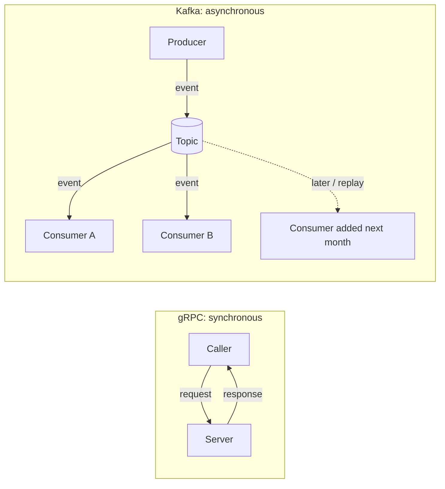
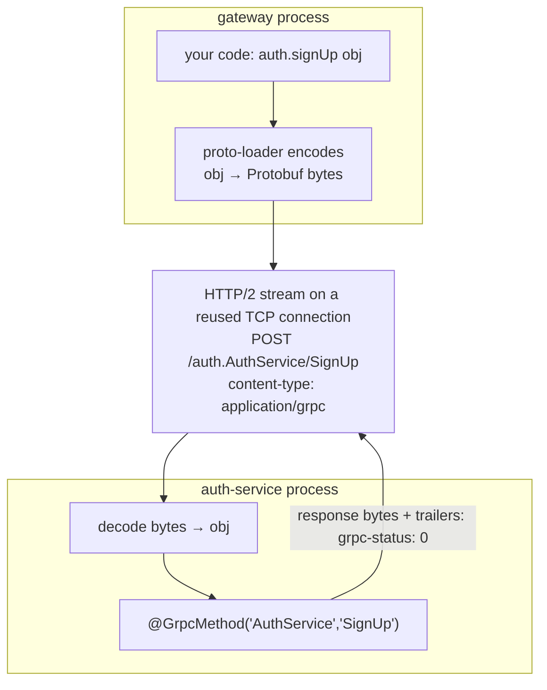
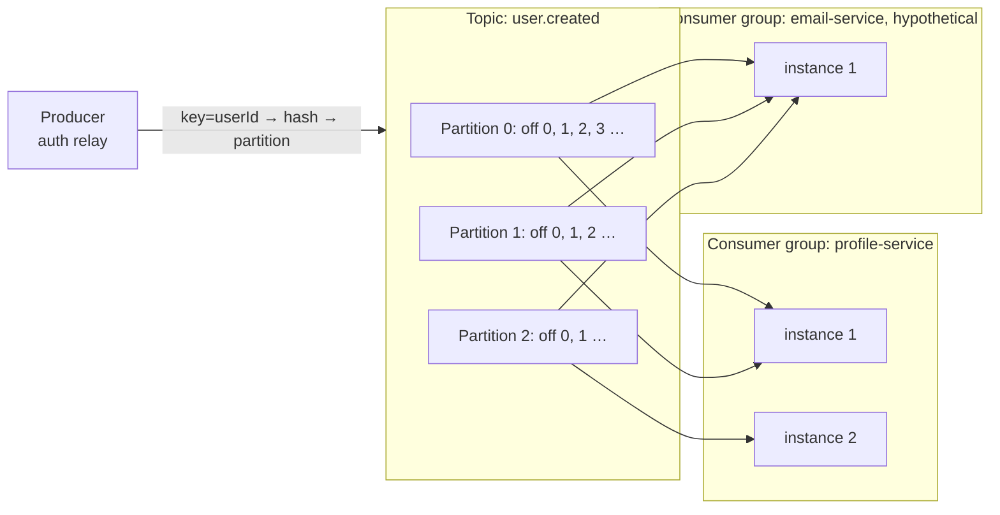
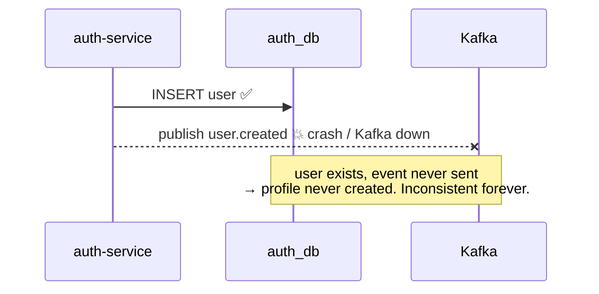
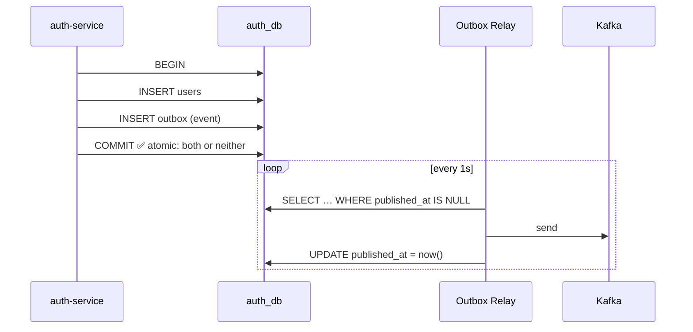

# gRPC vs Kafka: When, Why, How (+ Interview Q&A)

## 1. The one-sentence rule

> **gRPC = a phone call.** You ask, you wait, you get an answer. Both people must be there.
> **Kafka = a noticeboard.** You pin a note ("Riya signed up") and walk away. Whoever cares reads it whenever they come by, even tomorrow.



## 2. Decision table

| Ask yourself | gRPC | Kafka |
|---|---|---|
| Do I need the **result** to continue? | ✅ | ❌ |
| Is it a **query** (read)? | ✅ | ❌ |
| Is it a **fact that already happened**? | ❌ | ✅ |
| Should the caller **fail** if the receiver is down? | ✅ (fail fast) | ❌ (wait and deliver later) |
| **Many** services may react, and I don't want to know them? | ❌ | ✅ |
| Need to **replay** history / rebuild a service's data? | ❌ | ✅ |
| Need very **low latency**, one hop? | ✅ (~ms) | ⚠️ (ms–s, plus polling/batching) |
| Spiky load, want to **buffer** work? | ❌ | ✅ |
| Need **ordering** per entity? | n/a | ✅ (per partition, via key) |

**In this project:**

| Interaction | Tool | Why |
|---|---|---|
| gateway → auth `SignUp` / `Login` | gRPC | browser waits for the token |
| gateway → auth `ValidateToken` | gRPC | can't continue without knowing who you are |
| gateway → profile `GetProfile` | gRPC | it's a read; the user is waiting |
| interaction → profile `GetProfile` | gRPC | must know the user exists **before** saving |
| auth → `user.created` → profile | Kafka | a fact; signup shouldn't depend on profile |
| interaction → `user.followed` → profile | Kafka | a fact; counters can lag 1 s |
| `UpdateProfile` (bio) | gRPC only, no event | nobody else cares, so no event needed |

They're **not competitors**. Real systems use both: gRPC for the request path, Kafka for the side effects.

## 3. gRPC under the hood



| Feature | What it means | Why you care |
|---|---|---|
| **Protobuf** | binary, schema-based encoding | 3–10× smaller than JSON, faster to parse, typed contract |
| **HTTP/2** | binary framing, one TCP connection, many streams | no connection per request, no head-of-line blocking at HTTP level |
| **Multiplexing** | many calls in parallel on one connection | gateway serves 100s of users over 1 connection per service |
| **HPACK** | compressed headers | less overhead per call |
| **Streaming** | unary, server, client, bidi streams | live feeds and uploads, not possible in plain REST |
| **Deadlines** | caller says "I wait max X" | stops slow calls from piling up (we use 5 s) |
| **Status codes** | `OK, INVALID_ARGUMENT, NOT_FOUND, ALREADY_EXISTS, UNAUTHENTICATED, UNAVAILABLE, DEADLINE_EXCEEDED…` | richer than mixing HTTP codes for everything |
| **Codegen** | `.proto` → client/server stubs in any language | Go service can call a TS service with zero glue |

**gRPC weaknesses:** browsers can't call it directly (need gRPC-Web + proxy), binary isn't human-readable (you can't just `curl` it; use `grpcurl`), and the tight coupling means caller and callee must both be up.

## 4. Kafka under the hood



| Concept | Meaning |
|---|---|
| **Broker** | a Kafka server (we run 1; prod runs 3+) |
| **Topic** | named, **append-only log** of events |
| **Partition** | a topic is split into N logs, for parallelism. **Order is guaranteed only inside one partition** |
| **Key** | decides the partition (hash(key) % N). Same key → same partition → ordered. We use `userId` / `followeeId` |
| **Offset** | a message's position in its partition |
| **Consumer group** | consumers sharing work; **each partition is read by exactly one member** of the group. Max parallelism = number of partitions |
| **Multiple groups** | each group gets **every** message independently (pub/sub). Add an `email-service` group and it gets all `user.created` without touching profile |
| **Committed offset** | "this group has processed up to here". On restart, resume from there |
| **Retention** | messages are **kept** after being read (default 7 days), unlike a classic queue. That enables replay |
| **Replication** | in prod each partition is copied to several brokers; `acks=all` means "written to all in-sync replicas" |
| **KRaft** | Kafka's built-in metadata quorum; replaces ZooKeeper (our docker setup uses it) |

### Delivery guarantees
| Guarantee | How | Risk |
|---|---|---|
| at-most-once | commit offset **before** processing | crash → message lost |
| **at-least-once** (ours) | commit **after** processing | crash → message processed twice → **make consumers idempotent** |
| exactly-once | Kafka transactions (only Kafka→Kafka), or idempotent consumer + dedupe | complex; across a DB you usually do at-least-once + idempotency |

## 5. The Transactional Outbox pattern

### The problem: dual write
A service must **save data** AND **publish an event**. Two systems can't share one transaction.



### The fix: write the event into your own DB, in the same transaction



- If the transaction fails → no user **and** no event. Consistent.
- If Kafka is down → the relay keeps retrying. The event is safe in Postgres.
- If the relay crashes after `send` but before `UPDATE` → the event is sent **again**, which is why consumers dedupe with `eventId`.

**Relay variants:** polling (ours, simple) vs **CDC** (Debezium tails the Postgres WAL and streams outbox inserts to Kafka; no polling, lower latency, more infra).

### The other half: the Idempotent Consumer
```sql
BEGIN;
INSERT INTO processed_events(event_id) VALUES ($1) ON CONFLICT DO NOTHING;  -- 0 rows? seen it → stop
UPDATE profiles SET followers_count = followers_count + 1 WHERE …;
COMMIT;
```
**Outbox + idempotent consumer = reliable event-driven microservices without distributed transactions.**

## 6. Why not 2PC / distributed transactions?
Two-phase commit across Postgres and Kafka is slow, blocks on failures, and isn't really supported by Kafka. Microservices use **eventual consistency** instead: local transactions plus events. For multi-step business flows that can fail midway (order → payment → shipping), you use a **Saga**: a chain of local transactions with **compensating** actions on failure.

## 7. Could we have used only one of them?

**Only gRPC:** auth calls profile on signup. Signup breaks when profile is down, auth must know every downstream service, and there's no replay or buffering.
**Only Kafka:** the login form would publish "login requested" and then… wait for a reply event? Request/reply over Kafka works, but it's slow and awkward for reads. Queries want gRPC.

---

## 8. Interview Q&A

**Q: Walk me through what happens when a user signs up.**
Browser POSTs JSON to the gateway → gateway calls `AuthService.SignUp` over gRPC (HTTP/2, Protobuf) → auth validates, hashes the password, and in **one transaction** inserts the user and an outbox row → replies with userId and JWT → gateway returns 201. In the background the outbox relay publishes `user.created` to Kafka keyed by userId; profile-service's consumer group receives it and creates the profile idempotently. *(Full version: [overall.md §5](overall.md#5-story-1-riya-signs-up-the-most-important-flow).)*

**Q: Why gRPC between gateway and services instead of REST?**
Strict typed contract (`.proto`), smaller/faster binary payloads, HTTP/2 multiplexing over persistent connections, deadlines and standard status codes, codegen across languages. Internal traffic doesn't need to be human-readable.

**Q: Why REST between browser and gateway then?**
Browsers can't speak native gRPC (no access to HTTP/2 framing/trailers). The alternative is gRPC-Web plus a proxy like Envoy. REST/JSON is universal and easy to debug.

**Q: When would you choose Kafka over gRPC?**
When the sender doesn't need a reply: announcing facts, fan-out to many consumers, decoupling availability, buffering load spikes, keeping an audit log, or letting new services replay history.

**Q: When is Kafka the wrong choice?**
Reads and queries, anything the user is waiting on, anything needing an immediate yes/no (validation, auth), and small systems where the operational cost isn't worth it.

**Q: What's the outbox pattern and why do you need it?**
It solves the dual-write problem. Write the event to an outbox table in the same DB transaction as the business data; a relay publishes it to Kafka later. Guarantees that the event is published if and only if the data was committed.

**Q: 50,000 requests arrive, you can handle 30,000. How do you not crash?**
Kafka isn't the bottleneck: it stores millions on disk and consumers *pull*, so excess becomes lag, not a crash. Protect the *push* side: rate-limit at the gateway (429 + Retry-After), move non-urgent work onto Kafka (202 Accepted), cap gRPC concurrency with deadlines, have clients retry with backoff + jitter (safe thanks to idempotency keys), scale consumers by partitions. Full answer: [idempotency-and-backpressure.md](idempotency-and-backpressure.md#10-say-this-in-the-interview).

**Q: A client retries a signup after a timeout. What happens?**
It sends the same `Idempotency-Key`; auth finds the key (stored in the same transaction as the user) and returns the original account instead of a 409. No duplicate user, no duplicate event.

**Q: Kafka gives at-least-once. How do you handle duplicates?**
Every event carries a unique `eventId`. The consumer inserts it into `processed_events` in the same transaction as the side effect; a conflict means "already done", so skip.

**Q: How do you guarantee ordering?**
Only within a partition. Choose a key so related events share a partition. All of a user's events use `userId`, so they're processed in order. Across keys there's no global order (and you usually don't need it).

**Q: What's a consumer group?**
A set of instances of the same service sharing a topic. Kafka assigns each partition to exactly one member, so work is split and each message is processed once per group. Different groups each get all messages.

**Q: How do you scale profile-service?**
Run more instances. gRPC traffic is load-balanced across them; Kafka rebalances partitions across the group. Consumer parallelism is capped by the partition count (3 here).

**Q: What if profile-service is down when someone signs up?**
Signup still succeeds. The event waits in Kafka. When profile comes back, it resumes from its committed offset and creates the profile. The sync paths that need profile (dashboard, follow) return 503 meanwhile.

**Q: What if Kafka is down?**
Writes still succeed; events accumulate in the outbox tables and get published when Kafka recovers. Nothing is lost.

**Q: What's eventual consistency? Where do you see it here?**
Different services' data agrees after a short delay. Right after signup the profile may not exist for ~1 s (dashboard shows "being created…"); after following, the counter updates ~1 s later.

**Q: Why does each service have its own database?**
Independent deployment and schema changes, no hidden coupling through shared tables, failure isolation, and each service can pick the DB that fits. Data needed elsewhere is shared via APIs (gRPC) or events (Kafka copies).

**Q: profile stores name and email. Isn't that duplication?**
Yes, on purpose. It's a read copy fed by `user.created`; auth remains the source of truth. It removes a runtime dependency on auth. If emails could change, auth would publish `user.updated`.

**Q: How does the gateway know who the user is?**
`AuthGuard` sends the Bearer JWT to `AuthService.ValidateToken` via gRPC and puts the returned `userId` on the request. Services trust that `userId`; it never comes from the client body.

**Q: How do you evolve a .proto without breaking clients?**
Only add fields with new numbers; never change or reuse numbers or types; `reserved` removed ones. Unknown fields are ignored by old code.

**Q: What are gRPC deadlines and why set them?**
The max time a caller waits. Without them, a slow downstream causes requests to pile up and exhaust resources (cascading failure). We use 5 s at the gateway.

**Q: How would you make interaction-service not depend on profile being up?**
Consume `user.created` into a local `known_users` table and check existence locally. Or add retries, a circuit breaker and a fallback.

**Q: What would you change for production?**
TLS/mTLS between services; real migrations; multiple Kafka brokers with replication factor 3 and `acks=all`; CDC (Debezium) or `SKIP LOCKED` for the outbox; a dead-letter topic for poison messages; schema registry (Avro/Protobuf) for events; tracing (OpenTelemetry) across gRPC and Kafka; health checks; Kubernetes with service discovery; gateway JWT verification with public keys.

**Q: What's a poison message?**
A message that always fails processing (bad data). With retry-forever it blocks its partition. The fix: after N attempts, send it to a **dead-letter topic** and move on.

**Q: gRPC streaming: would you use it here?**
Possible for a live notification feed (server streaming). For this app unary is enough.

**Q: Kafka vs RabbitMQ?**
Kafka is a durable, replayable, partitioned log built for high throughput and multiple independent consumer groups. RabbitMQ is a message broker with flexible routing where messages are removed once acknowledged. Pick Kafka for event streams and replay; RabbitMQ for task queues and complex routing.
