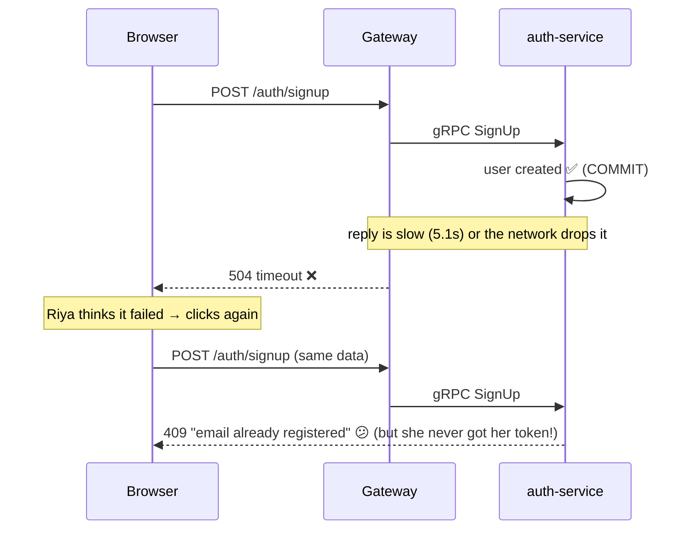
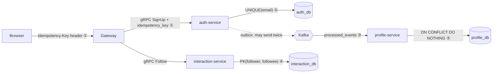
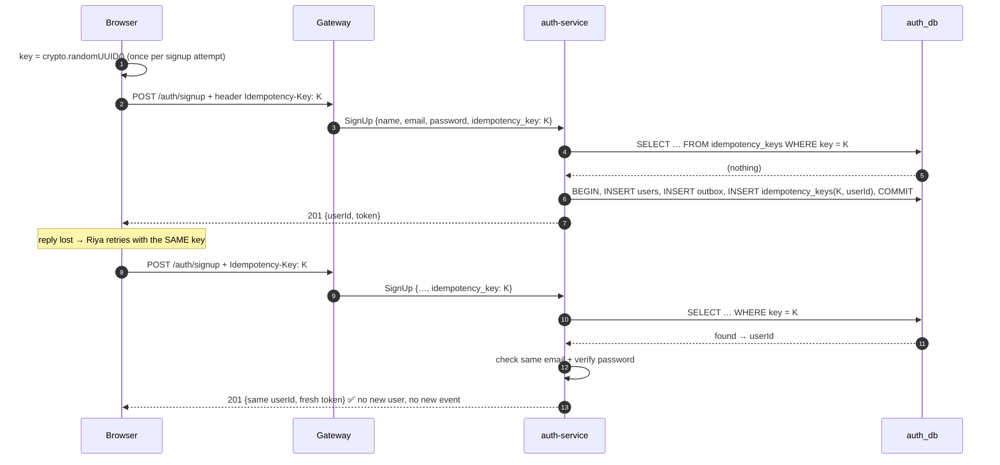
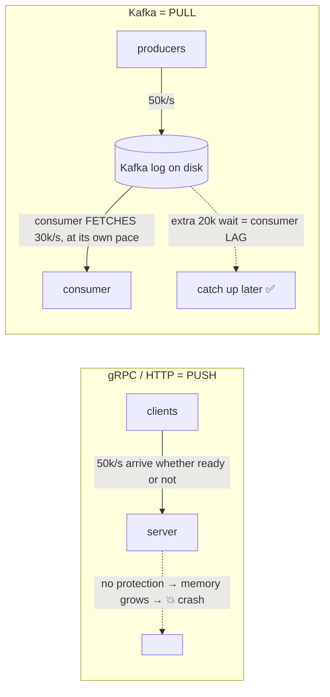
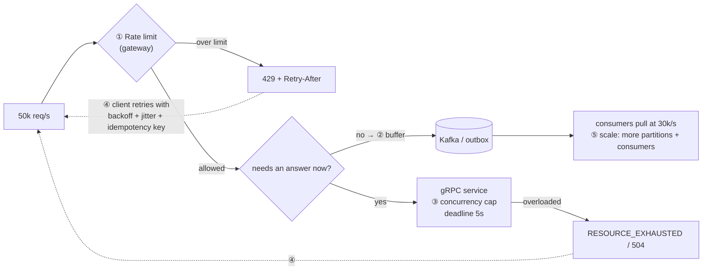

# Idempotency & Handling Overload

> Two interview favourites:
> 1. *"What happens if the same request or message arrives twice?"* → **idempotency**
> 2. *"50,000 requests arrive but you can only handle 30,000. How do you not crash?"* → **backpressure / load shedding**
>
> Everything below is implemented in this project and was tested.

---

# Part 1: Idempotency

## 1. What it means

**Idempotent = doing it twice has the same effect as doing it once.**

| Operation | Idempotent? |
|---|---|
| `SET bio = 'hello'` | ✅ yes: run it 5 times, bio is still 'hello' |
| `followers_count = followers_count + 1` | ❌ no: run it twice, you've counted 2 follows |
| "Create user Riya" | ❌ no by default: the 2nd time fails or creates a duplicate |

## 2. Why duplicates happen at all

Networks are unreliable, so **every system that retries can produce duplicates**:



And on the Kafka side, the outbox relay can send an event twice (crash after `send`, before `UPDATE published_at`). That's **at-least-once delivery**.

**You can't stop duplicates from arriving. You make the receiver handle them safely.**

## 3. Where this project is idempotent (5 layers)



| # | Where | Protects against | How |
|---|---|---|---|
| ① | **SignUp request** | Client retry after a timeout | **Idempotency key** (below) |
| ② | `users.email UNIQUE` | Two signups with the same email | Database constraint, so only one can win |
| ③ | profile consumer | Kafka redelivering an event | `processed_events(event_id)` table, same transaction as the change |
| ④ | `follows` primary key | Double-click on Follow | `ON CONFLICT DO NOTHING`, and **no second event is published** |
| ⑤ | `profiles` insert | `user.created` replayed | `ON CONFLICT (user_id) DO NOTHING` |

Login, GetProfile, ListProfiles, GetFollowing and UpdateProfile are **naturally idempotent** (reads, or "set to X").

## 4. The idempotency key (how ① works)

### The flow



### The pieces

| Layer | File | What it does |
|---|---|---|
| Frontend | `frontend/app/page.tsx` | Makes a UUID per signup **attempt**. Re-clicking reuses it; editing a field makes a new one (different data = different request) |
| Gateway | `gateway/src/auth.controller.ts` | Reads the `Idempotency-Key` header and passes it into the gRPC request |
| Contract | `proto/auth.proto` | `string idempotency_key = 4;` was **added as a new field number**, so old clients still work (that's safe proto evolution in action) |
| Auth | `services/auth/src/auth.controller.ts` | `replay()` looks the key up first; the key is inserted **in the same transaction** as the user and the outbox event |
| DB | `services/auth/src/db.ts` | `idempotency_keys(key PK, user_id, created_at)` |

### The subtle parts (great for follow-up questions)

1. **Same transaction.** The key is saved with the user, atomically. "Key exists" ⇔ "user was created". If they were separate, a crash in between would break the guarantee.
2. **Two retries at the same moment.** Both miss the lookup and both try to INSERT. Postgres' `UNIQUE(email)` makes one wait and then fail (`23505`). The loser **looks the key up again** and returns the winner's result. *(Tested: two parallel requests → same userId, 1 user row, 1 outbox event.)*
3. **A key can't be abused.** Reusing a key with a different email, or the wrong password, returns `400 "idempotency key was already used for a different request"`. Without the password check, anyone who learned a key could get a token for that account.
4. **The response isn't stored, it's rebuilt.** We store `user_id` and issue a fresh token, which is fine because tokens aren't "the" result. Stripe-style APIs store the whole response body.
5. **Cleanup.** Keys only need to live as long as a client might retry (Stripe: 24 h). We keep them forever, marked as a TODO in the code.

**Why the key travels as a proto field rather than gRPC metadata:** both are valid. Metadata (headers) is the usual place for cross-cutting concerns like auth tokens and trace ids. A field is more explicit and easier to see while learning. Mention both.

## 5. The consumer side (how ③ works)

```sql
BEGIN;
INSERT INTO processed_events(event_id) VALUES ($1) ON CONFLICT DO NOTHING;
-- 0 rows inserted → already processed → ROLLBACK and skip
UPDATE profiles SET followers_count = followers_count + 1 WHERE user_id = $2;
COMMIT;   -- then kafkajs commits the Kafka offset
```
- The dedupe record and the side effect commit **together**.
- Crash before COMMIT: nothing applied, offset not committed, Kafka redelivers, and it's processed cleanly.
- Crash after COMMIT, before the offset commit: redelivered, dedupe says "seen", skipped. ✅

**Outbox (at-least-once out) + idempotent consumer (dedupe in) ≈ effectively exactly-once.**

---

# Part 2: 50,000 requests, capacity 30,000

## 6. First, correct the premise

**Kafka doesn't "hold 30k requests".** Kafka writes to disk and holds **millions** of messages. Its limits are disk space and retention time. What actually maxes out is the **thing doing the work**: a gRPC server, a consumer, or a **database** (connections, CPU).

So the real question is: **the producer is faster than the consumer. What do you do?**

## 7. The key insight: push vs pull



- **Kafka can't overwhelm a consumer.** The consumer asks for the next batch only when it's done with the current one. Extra load becomes **lag** (a growing backlog), not a crash.
- **gRPC and HTTP can overwhelm a server**, because requests arrive whether it's ready or not. That's where you need explicit protection.

## 8. The answer, in layers



| # | Technique | What it does | In this project |
|---|---|---|---|
| ① | **Rate limiting** (load shedding at the edge) | Reject the excess **cheaply and early** with `429 Too Many Requests` + `Retry-After`. Rejecting 20k cleanly beats crashing for all 50k | ✅ `gateway/src/rate-limit.guard.ts`: 50 req / 10 s per IP (env `RATE_LIMIT`, `RATE_WINDOW_MS`) |
| ② | **Buffer with a queue** (queue-based load leveling) | Work that doesn't need an immediate answer goes into Kafka and the API returns `202 Accepted`. Consumers drain the backlog at a sustainable rate | ✅ Side effects (profile creation, counters) already flow through outbox + Kafka. A signup flood only grows Kafka lag; profile-service is never overwhelmed |
| ③ | **Backpressure on gRPC** | Cap concurrent work per server. Excess waits at the **caller** or fails fast (`RESOURCE_EXHAUSTED`) instead of piling up in server memory. Deadlines stop waiters from waiting forever | ✅ `grpc.max_concurrent_streams: 100` in each service's `main.ts`; 5 s deadline in `gateway/src/grpc-call.ts`; `RESOURCE_EXHAUSTED` → 429 |
| ④ | **Smart retries** | Exponential backoff + random **jitter** so clients don't all retry at the same instant; a **circuit breaker** stops calling a struggling service for a while. Retries are safe only because of **idempotency** (Part 1) | ⚠️ idempotency keys ✅; client backoff and circuit breaker not implemented |
| ⑤ | **Scale out** | More service replicas behind a load balancer. For Kafka: more **partitions** + more consumers in the group (max parallel consumers = partitions). Autoscale on **consumer lag** or CPU | ⚠️ conceptual: topics have 3 partitions, so up to 3 profile consumers |
| ⑥ | **Prioritize / degrade** | Under extreme load, keep the critical path (login, payments) and drop or delay the rest (analytics, recommendations) | ⚠️ conceptual |

### How each part of our system reacts to a 50k signup burst

| Component | Reaction |
|---|---|
| Gateway | Anything over 50 req / 10 s per IP gets an immediate 429. No gRPC call, no DB hit |
| auth-service | At most 100 concurrent calls per gateway connection; its DB pool (10 connections) is the real ceiling. Slow → the gateway's 5 s deadline → 504 |
| Outbox → Kafka | The outbox table grows, and the relay publishes 100 rows per second-tick. Kafka holds everything on disk |
| profile-service | **Unaffected.** It pulls events at its own pace. Lag grows, then shrinks. Profiles appear late but nothing crashes |

## 9. Kafka-specific knobs (if they dig deeper)

| Knob | Effect |
|---|---|
| **Partitions** | Ceiling on consumer parallelism. Can be increased, but that reshuffles which key goes where |
| **Consumer group size** | Add instances up to the partition count; Kafka rebalances automatically |
| **Batch consumption** (`eachBatch`, `maxBytes`) | Fewer round trips; e.g. one DB transaction per 500 events |
| **Retention** (`retention.ms` / `retention.bytes`) | How long the backlog can survive. If consumers lag beyond retention, **data is lost**, so monitor lag |
| **Producer** `acks`, `linger.ms`, `batch.size`, compression | Producer throughput vs latency/durability. Java's `buffer.memory` + `max.block.ms` = producer-side backpressure |
| **Consumer lag monitoring** | The #1 health metric: Kafka UI (`:8080`) shows it per group |

## 10. Say this in the interview

> "Duplicates are inevitable with retries and at-least-once delivery, so every write path here is idempotent. Client retries carry an **idempotency key** stored in the same transaction as the user; DB constraints stop duplicate rows; the Kafka consumer dedupes by **eventId** in the same transaction as its update.
>
> For 50k requests against 30k capacity: Kafka isn't the bottleneck, because it stores millions on disk and consumers **pull**, so excess load becomes **lag**, not a crash. The danger is the **push** side. So I **rate-limit at the gateway** and return 429 with Retry-After, move anything that doesn't need an immediate answer **onto Kafka and return 202**, cap gRPC **concurrency** with **deadlines** so servers fail fast instead of running out of memory, have clients **retry with backoff and jitter** (safe because of idempotency keys), and **scale consumers by partitions**, autoscaling on lag."

## 11. Try it yourself

```bash
# idempotent retry: run twice → same userId both times, 201 both times
curl -X POST localhost:3001/auth/signup -H "Content-Type: application/json" \
  -H "Idempotency-Key: demo-1" -d '{"name":"Riya","email":"riya@demo.com","password":"secret123"}'

# rate limit: request #51 within 10 s gets 429
for i in $(seq 1 60); do curl -s -o /dev/null -w "%{http_code}\n" -X POST localhost:3001/auth/login \
  -H "Content-Type: application/json" -d '{}'; done | sort | uniq -c
#   50 401   ← allowed through (wrong login, that's fine)
#   10 429   ← shed at the gateway
```
