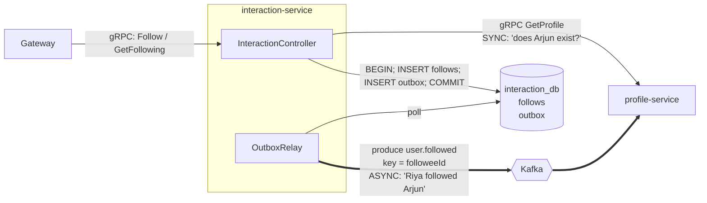

# interaction-service

> Folder: `services/interaction/src/` · gRPC on **:50053** · DB **interaction_db** (Postgres :5435) · gRPC **client** of profile-service · Kafka **producer** of `user.followed`

## 1. What it is

Owns **relationships between users**: who follows whom.
It's the best example of choosing **gRPC vs Kafka inside one operation**:



It's a gRPC **server** (for the gateway) **and** a gRPC **client** (of profile-service). Service-to-service gRPC.

## 2. Database: `interaction_db`

```sql
follows (follower_id UUID, followee_id UUID, created_at, PRIMARY KEY (follower_id, followee_id))
outbox  (id, topic, message_key, payload JSONB, created_at, published_at)
```
The composite primary key means "Riya follows Arjun" can exist **only once**. The DB enforces it, not app code.

## 3. The gRPC methods

### `Follow(FollowRequest) → FollowResponse`
**Input:** `{ follower_id, followee_id }`. `follower_id` is set by the gateway **from the JWT**, so a user can only follow *as themselves*.

**What it does:**
1. Both ids present? Not following yourself? Else `INVALID_ARGUMENT`.
2. **Sync gRPC call → `ProfileService.GetProfile(followee_id)`**
   - `NOT_FOUND` → reply `NOT_FOUND` "user to follow does not exist"
   - other error (profile down) → reply `UNAVAILABLE`
3. **One transaction:**
   ```sql
   BEGIN;
   INSERT INTO follows (riya, arjun) ON CONFLICT DO NOTHING;
   -- 0 rows inserted? already following → ROLLBACK, return "already following" (no event!)
   INSERT INTO outbox (..., 'user.followed', arjunId, '{"followerId":riya,"followeeId":arjun}');
   COMMIT;
   ```
4. The relay publishes `user.followed` to Kafka within ~1 s. profile-service bumps the counters.

**Returns:** `{ success: true, message: "followed" | "already following" }`
**Errors:** `INVALID_ARGUMENT`, `NOT_FOUND`, `UNAVAILABLE`

### `GetFollowing(GetFollowingRequest) → GetFollowingResponse`
**Input:** `{ user_id }` · **Does:** `SELECT followee_id FROM follows WHERE follower_id = $1`
**Returns:** `{ followee_ids: string[] }`. The UI uses it to show "Following" instead of a button.

## 4. Why gRPC for the check, but Kafka for the counter?

| Step | Question | Needs answer before continuing? | Tool |
|---|---|---|---|
| Does Arjun exist? | "Can I accept this request?" | **Yes**. We must not save a follow to a non-existent user | **gRPC** |
| Update Arjun's follower count | "Tell profile it happened" | **No**. A 1 s delay in a counter is fine | **Kafka** |

Bad alternatives and why:
- **Read profile_db directly** → breaks *database per service*. Profile can't change its schema without breaking interaction.
- **gRPC `profile.IncrementFollowers`** after saving → if profile is down after we committed, the counter is lost (the dual-write problem again), and Follow gets slower.
- **Kafka for the existence check** → Kafka has no "reply". You can't wait on it for an answer (you *can* build request/reply on Kafka, but it's awkward).

## 5. Sync-dependency trade-off (good interview talking point)

Because `Follow` calls profile synchronously, **Follow is down when profile is down**. Ways to reduce that:
- Keep a **local copy** of existing user ids in interaction_db, fed by `user.created` (the same trick profile uses with auth). Then no sync call is needed.
- Add **retries with backoff** and a **circuit breaker** around the gRPC call.

We kept the sync call on purpose, to show service-to-service gRPC.

## 6. Failure scenarios

| Situation | Result |
|---|---|
| profile-service down | Follow → 503; GetFollowing still works (only needs own DB) |
| Kafka down | Follow succeeds; event waits in outbox; counters update later |
| Riya clicks Follow twice | 2nd insert hits `ON CONFLICT DO NOTHING` → "already following", no second event |
| Relay sends the event twice | profile-service's `processed_events` dedupes |

## 7. Files
| File | What |
|---|---|
| `main.ts` | gRPC server on 50053 with `interaction.proto` |
| `app.module.ts` | registers the **profile gRPC client** (`PROFILE_PACKAGE`) + Db + OutboxRelay |
| `interaction.controller.ts` | `Follow` (with sync profile check), `GetFollowing` |
| `outbox-relay.ts` | outbox → Kafka (same pattern as auth's) |
| `db.ts` | `follows` + `outbox` tables |
