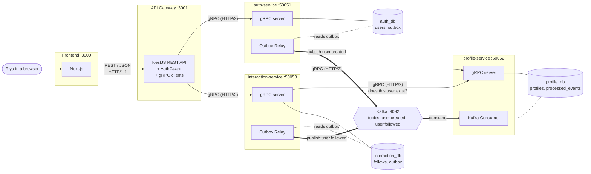
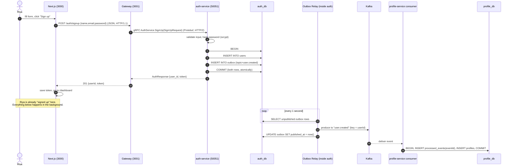
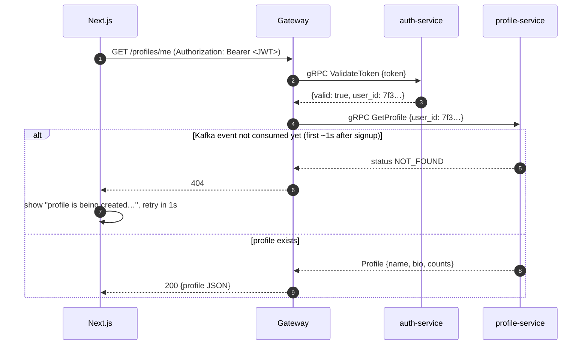
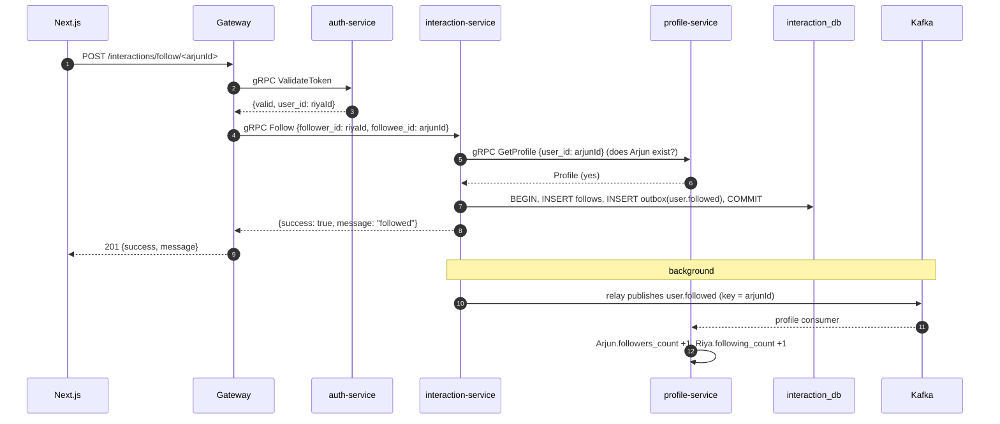

# KafkaGrpcFlow: The Whole Picture

> Read this first. Every other doc zooms into one box from the diagrams below.
>
> Tip: diagrams are Mermaid. They render on GitHub. In VS Code, install **"Markdown Preview Mermaid Support"** and press `Ctrl+Shift+V`.

---

## 1. The 30-second answer (say this in the interview)

> "It's a small social app split into **three microservices**: **Auth**, **Profile** and **Interaction**. Each one has **its own Postgres database**.
> The **Next.js** frontend talks only to a **NestJS API Gateway** over plain REST/JSON.
> The gateway talks to the services over **gRPC**. That's binary Protobuf over HTTP/2, used whenever someone **needs an answer right now** ("is this token valid?", "give me this profile").
> When something **has happened** that other services should know about ("Riya signed up", "Riya followed Arjun"), the service doesn't call anyone. It writes an **event** into an **outbox table** in the same DB transaction, and a relay publishes it to **Kafka**. Interested services **consume** it in the background.
> So: **gRPC for questions and commands that need a reply. Kafka for facts that other services react to in their own time.**"

---

## 2. The architecture



**Legend**
- Thin solid arrow → **synchronous** call (caller waits for a reply): REST or gRPC
- Thick arrow → **asynchronous** event via Kafka (fire and forget, nobody waits)
- Cylinder → a database that **only its own service** can touch

---

## 3. Who's who

| Piece | Port | Speaks | Owns DB | Job in one line |
|---|---|---|---|---|
| **Frontend** (Next.js) | 3000 | REST → gateway | none (token in localStorage) | Forms and screens |
| **API Gateway** (NestJS) | 3001 | REST in, gRPC out | none | Single front door: auth check, routing, REST↔gRPC translation |
| **auth-service** | 50051 | gRPC server, Kafka **producer** | `auth_db` (5433): `users`, `outbox` | Accounts, passwords, JWT tokens |
| **profile-service** | 50052 | gRPC server, Kafka **consumer** | `profile_db` (5434): `profiles`, `processed_events` | Public profile (name, bio, follower counts) |
| **interaction-service** | 50053 | gRPC server, gRPC **client** (of profile), Kafka **producer** | `interaction_db` (5435): `follows`, `outbox` | Who follows whom |
| **Kafka** | 9092 | Kafka protocol | its own log files | Durable event pipe between services |
| **Kafka UI** | 8080 | web | none | See topics/messages in a browser |
| **proto/** | n/a | n/a | n/a | The contracts (`.proto` files) every gRPC call follows |

---

## 4. Three ways things talk (the core idea)

| | REST / JSON | gRPC | Kafka |
|---|---|---|---|
| **Where here** | Browser ↔ Gateway | Gateway ↔ services, service ↔ service | service → Kafka → service |
| **Style** | Request/response | Request/response | Publish/subscribe (events) |
| **Caller waits?** | Yes | Yes | **No** |
| **Format** | JSON text | Protobuf binary | JSON text (here; could be Avro/Protobuf) |
| **Transport** | HTTP/1.1 | HTTP/2 | Kafka TCP protocol |
| **Contract** | informal | **strict** `.proto` file | topic name + event shape |
| **If receiver is down** | caller gets error | caller gets `UNAVAILABLE` | message **waits in Kafka** until receiver is back |
| **Use it for** | public API for browsers | "I need the answer now" | "This happened, react when you can" |

Why not gRPC from the browser? Browsers can't speak raw gRPC: they don't expose HTTP/2 frames and trailers to JavaScript. You'd need gRPC-Web plus a proxy (Envoy). The gateway gives the browser simple REST and keeps gRPC internal.

---

## 5. Story 1: Riya signs up (the most important flow)

Riya opens `http://localhost:3000`, types **name = Riya, email = riya@mail.com, password = secret123** and clicks **Sign up**.



### Step by step, in plain words

1. **Browser → Gateway (REST).** Next.js sends `POST http://localhost:3001/auth/signup` with JSON body `{ "name": "Riya", "email": "riya@mail.com", "password": "secret123" }`.
2. **Gateway → Auth (gRPC).** The gateway's `AuthController` has no business logic. It calls `AuthService.SignUp` over gRPC. The gateway already holds a **long-lived HTTP/2 connection** (a gRPC *channel*) to auth-service, opened on first use and reused for every request. Many calls can share it at once (HTTP/2 *multiplexing*). The JSON is turned into a compact **Protobuf binary** message defined in `proto/auth.proto`.
3. **Auth validates.** Name present, email has `@`, password ≥ 6 chars. If not, it throws gRPC status `INVALID_ARGUMENT` and the gateway turns that into **HTTP 400**.
4. **Auth hashes the password** with `scrypt` + random salt. The plain password is never stored.
5. **One DB transaction, two inserts:**
   - `users` ← Riya's row
   - `outbox` ← an event row: `topic = 'user.created'`, `payload = {userId, name, email}`

   Both commit or neither does. That's the **Transactional Outbox pattern**. If the email already exists, Postgres' `UNIQUE` constraint fails → gRPC `ALREADY_EXISTS` → **HTTP 409**.
6. **Auth replies** `{ user_id, token }`. The token is a **JWT** signed with a secret, valid for 1 hour.
7. **Gateway → Browser.** The gateway passes it back as JSON. Next.js stores the token in `localStorage` and navigates to `/dashboard`.
8. **In the background (≈ 1 s later):** the **Outbox Relay** inside auth-service polls the `outbox` table, finds the new row and **produces** it to Kafka topic `user.created`, using `userId` as the message key. Then it marks the row `published_at = now()`.
9. **Kafka stores the message** in one of the topic's 3 partitions (chosen by hashing the key).
10. **profile-service's consumer** (consumer group `profile-service`) receives it. In one transaction it:
    - inserts `eventId` into `processed_events` (if it's already there, this is a duplicate, so it skips),
    - inserts Riya's row into `profiles` (name, email, bio = '', counts = 0).
11. Kafka records that the consumer group has processed that **offset**.

### What each database holds after signup

| DB | Table | Row |
|---|---|---|
| auth_db | users | `id=7f3…, name=Riya, email=riya@mail.com, password_hash=salt:hash` |
| auth_db | outbox | `id=e1…, topic=user.created, payload={userId, name, email}, published_at=<time>` |
| profile_db | profiles | `user_id=7f3…, name=Riya, email=riya@mail.com, bio='', followers=0, following=0` |
| profile_db | processed_events | `event_id=e1…` |
| interaction_db | n/a | nothing yet |

### Why not just call profile-service over gRPC from auth?
You could: `auth.SignUp → profile.CreateProfile`. But then:
- If profile-service is down, **signup fails**, even though auth did its job.
- Auth must **know about** profile. Add a 4th service that cares about new users (email, analytics) and you're editing auth again.
- Auth waits for profile, so it's slower.

With Kafka, auth just announces "a user was created". It doesn't know or care who listens. New listeners can subscribe tomorrow without touching auth, and can even **replay old events** (`fromBeginning: true`).

### Why the outbox and not just `producer.send()` after the INSERT?
The **dual-write problem**: you write two different systems (Postgres and Kafka) and can't make them atomic.

| Order | Crash between the two writes → |
|---|---|
| INSERT user, then send to Kafka | user exists, **no event** → Riya never gets a profile |
| send to Kafka, then INSERT user | event exists, **no user** → ghost profile |

The outbox turns two writes into **one local DB transaction**. The relay retries until Kafka accepts. Deep dive in [grpc-vs-kafka.md](grpc-vs-kafka.md#5-the-transactional-outbox-pattern).

---

## 6. Story 2: Riya opens the dashboard (a protected request + eventual consistency)



1. Every protected route has the gateway's **`AuthGuard`**. It reads the `Authorization` header and asks auth-service over gRPC: `ValidateToken`.
2. Auth verifies the JWT signature and expiry and returns `{ valid, user_id }`. The guard attaches `userId` to the request. **The caller's identity always comes from the token, never from the request body**, so Riya can't pretend to be Arjun.
3. The gateway calls `ProfileService.GetProfile` over gRPC.
4. **Eventual consistency:** signup returned *before* Kafka delivered `user.created`. For about a second, profile-service may not have Riya yet, so it returns `NOT_FOUND`. The frontend shows "Your profile is being created…" and retries. This is the trade-off of async: **faster, decoupled, resilient, but not instantly consistent**. Be ready to explain it.

Then the dashboard also calls `GET /profiles` (ListProfiles) and `GET /interactions/following` (GetFollowing). Each one is: guard → gRPC → JSON.

---

## 7. Story 3: Riya edits her bio (plain sync gRPC, no Kafka)

`PATCH /profiles/me {bio}` → guard → `ProfileService.UpdateProfile {user_id, bio}` → `UPDATE profiles …` → updated Profile back.

No event is published: nobody else cares about bios. **Not everything needs Kafka.** Use events only when another service needs to react.

---

## 8. Story 4: Riya follows Arjun (gRPC *between services* + Kafka)

Arjun signed up in another browser. Riya sees him under **People** and clicks **Follow**.



This one flow uses **both** tools, each for the right reason:

- **gRPC interaction → profile (sync):** "Does Arjun exist?" We must know **before** saving the follow. That's a question that needs an answer now, so gRPC.
- **Kafka interaction → profile (async):** "Riya followed Arjun." Interaction doesn't need to wait for counters to update. That's a fact to announce, so Kafka.

Notice that **interaction-service never touches profile_db**. It can't UPDATE the counters itself. It asks over gRPC and announces over Kafka. That's what *database per service* means.

Follow twice? The `follows` table has `PRIMARY KEY (follower_id, followee_id)`, so the second INSERT does nothing and **no second event** is published. Counters stay correct.

---

## 9. Story 5: Riya logs in again

`POST /auth/login {email, password}` → `AuthService.Login` → look up user, re-hash the password with the stored salt, constant-time compare → new JWT. A wrong email and a wrong password give the **same** error (`UNAUTHENTICATED` → 401), so attackers can't discover which emails exist.

---

## 10. What happens when something breaks?

| Failure | What the user sees | Why |
|---|---|---|
| **Kafka is down** during signup | Signup **still works** | Event waits in the `outbox` table; relay retries every second |
| **profile-service is down** during signup | Signup **still works**; profile appears when it's back | Event waits **in Kafka**; consumer resumes from its last committed offset |
| **profile-service is down**, user opens dashboard | 503 error | Sync gRPC needs the server alive. That's the cost of sync |
| **profile-service is down**, user clicks Follow | 503 "profile-service unavailable" | Follow needs a sync existence check |
| **auth-service is down** | All protected routes fail (401/503) | Every request validates the token via auth |
| Relay crashes **after** sending but **before** marking published | Event sent **twice** | At-least-once. Consumer's `processed_events` dedupes it |
| Consumer crashes mid-processing | Event re-delivered | Offset not committed; DB transaction rolled back. Clean retry |
| A service is slow (>5 s) | 504 | Gateway puts a 5 s deadline on every gRPC call |
| Riya's signup reply is lost and she clicks again | Same account back (201), not 409 | Idempotency key: same key → original result |
| A flood of requests from one client | 429 + `Retry-After` | Gateway rate limit sheds load before it reaches services |

**Rule of thumb:** Kafka paths **degrade gracefully** (delayed). gRPC paths **fail fast** (error now).

---

## 11. Data ownership: why does profile store name and email too?

Each service owns its data. **No service ever queries another service's DB.**
profile-service needs name and email to show profiles, but auth owns users. Two options:

1. Call auth over gRPC every time a profile is shown → slow, and profile breaks when auth breaks.
2. **Keep a local copy** fed by the `user.created` event → fast and independent. ✅ (what we do)

Duplicating data **on purpose**, synced by events, is normal in microservices. Auth stays the **source of truth**. Profile holds a **read copy**.

---

## 12. Kafka topics in this project

| Topic | Producer | Consumer(s) | Key | Payload |
|---|---|---|---|---|
| `user.created` | auth-service (outbox relay) | profile-service | `userId` | `{eventId, occurredAt, userId, name, email}` |
| `user.followed` | interaction-service (outbox relay) | profile-service | `followeeId` | `{eventId, occurredAt, followerId, followeeId}` |

Each topic has 3 partitions. The key decides the partition, so all events for the same key stay **in order**.

---

## 13. All gRPC methods at a glance

| Service | RPC | Called by | Request → Response |
|---|---|---|---|
| AuthService | SignUp | gateway | `{name,email,password}` → `{user_id, token}` |
| AuthService | Login | gateway | `{email,password}` → `{user_id, token}` |
| AuthService | ValidateToken | gateway (AuthGuard) | `{token}` → `{valid, user_id, email}` |
| ProfileService | GetProfile | gateway, **interaction-service** | `{user_id}` → `Profile` |
| ProfileService | UpdateProfile | gateway | `{user_id, bio}` → `Profile` |
| ProfileService | ListProfiles | gateway | `{}` → `{profiles: Profile[]}` |
| InteractionService | Follow | gateway | `{follower_id, followee_id}` → `{success, message}` |
| InteractionService | GetFollowing | gateway | `{user_id}` → `{followee_ids[]}` |

REST routes on the gateway:

| REST | → gRPC | Auth? |
|---|---|---|
| `POST /auth/signup` | AuthService.SignUp | no |
| `POST /auth/login` | AuthService.Login | no |
| `GET /profiles` | ProfileService.ListProfiles | yes |
| `GET /profiles/me` | ProfileService.GetProfile | yes |
| `PATCH /profiles/me` | ProfileService.UpdateProfile | yes |
| `POST /interactions/follow/:userId` | InteractionService.Follow | yes |
| `GET /interactions/following` | InteractionService.GetFollowing | yes |

---

## 14. Folder map

```
kafkagrpcflow/
├── docker-compose.yml        Kafka (+UI) and 3 Postgres DBs
├── proto/                    THE CONTRACTS → docs/proto.md
│   ├── auth.proto
│   ├── profile.proto
│   └── interaction.proto
├── frontend/                 Next.js (app/page.tsx = signup/login, app/dashboard = dashboard)
├── gateway/src/              → docs/gateway.md
│   ├── grpc-clients.ts       gRPC client connections + TS types
│   ├── grpc-call.ts          deadline + gRPC→HTTP error mapping
│   ├── rate-limit.guard.ts   per-IP rate limit → 429
│   ├── auth.guard.ts         token check via AuthService.ValidateToken
│   └── *.controller.ts       REST routes → gRPC calls
└── services/
    ├── auth/src/             → docs/auth-service.md
    │   ├── auth.controller.ts   SignUp / Login / ValidateToken
    │   ├── db.ts                users + outbox tables
    │   └── outbox-relay.ts      outbox → Kafka
    ├── profile/src/          → docs/profile-service.md
    │   ├── profile.controller.ts  GetProfile / UpdateProfile / ListProfiles
    │   ├── events.consumer.ts     Kafka → profiles
    │   └── db.ts
    └── interaction/src/      → docs/interaction-service.md
        ├── interaction.controller.ts  Follow / GetFollowing (+ gRPC client to profile)
        ├── outbox-relay.ts
        └── db.ts
```

---

## 15. Run it and watch it

```bash
# 1. start Docker Desktop, then:
npm install
npm run infra:up      # Kafka, Kafka UI, 3x Postgres (waits until the DBs are healthy)
npm run dev           # auth, profile, interaction, gateway, frontend (all at once, colored logs)
```

Open http://localhost:3000. Sign up as **Riya**. In a private window sign up as **Arjun**. Follow each other.

**Watch the logs.** They narrate the flow:
```
[auth]        SignUp ok: riya@mail.com (7f3…), user.created saved to outbox
[auth]        outbox -> kafka: user.created key=7f3… eventId=e1…
[profile]     kafka <- user.created p1 offset=0 eventId=e1…
[interaction] Follow ok: 7f3… -> 9a2…, user.followed saved to outbox
[interaction] outbox -> kafka: user.followed key=9a2… eventId=c4…
[profile]     kafka <- user.followed p2 offset=0 eventId=c4…
```

For the first few seconds after `infra:up`, kafkajs may print some red `ECONNRESET` / `group coordinator is not available` lines while Kafka finishes booting. They're harmless; the services retry on their own.

**See Kafka:** http://localhost:8080 → Topics → `user.created` → Messages.

**Peek into a DB:**
```bash
docker compose exec auth-db psql -U postgres -d auth_db -c "select topic, published_at from outbox"
docker compose exec profile-db psql -U postgres -d profile_db -c "select name, followers_count from profiles"
```

**Prove resilience (great demo):** run each app in its own terminal instead of `npm run dev`:
```bash
npm start -w services/auth
npm start -w services/profile
npm start -w services/interaction
npm start -w gateway
npm run dev -w frontend
```
Stop the profile terminal (Ctrl+C). Sign up a new user: **signup still succeeds** (async path), but the dashboard shows an error (sync gRPC to profile fails). Start profile again: its log shows it consuming the missed `user.created` event. Refresh, and the profile is there.

---

## 16. Glossary

| Term | Meaning |
|---|---|
| **Microservice** | Small app owning one business area and its own data |
| **API Gateway** | Single entry point for clients; routes, authenticates, translates |
| **gRPC** | Google's RPC framework: call a function on another server as if it were local. Protobuf over HTTP/2 |
| **Protobuf** | Binary format + schema language (`.proto`) for messages |
| **HTTP/2** | Newer HTTP: binary framing, many parallel streams over one TCP connection, header compression |
| **Channel** | A gRPC client's long-lived connection to a server |
| **Unary RPC** | One request → one response (all our RPCs) |
| **Deadline** | Max time a caller will wait for a gRPC reply |
| **Kafka** | Distributed, durable, append-only log of events |
| **Topic** | Named stream of events (`user.created`) |
| **Partition** | A topic is split into partitions for parallelism; order is guaranteed only within one |
| **Offset** | Position of a message in a partition (0, 1, 2…) |
| **Producer / Consumer** | Writes to / reads from a topic |
| **Consumer group** | Set of consumers sharing a topic's work; each partition is read by one member |
| **Outbox pattern** | Save the event in your DB in the same transaction as the data; relay publishes it later |
| **At-least-once** | Every message is delivered, maybe more than once |
| **Idempotent** | Doing it twice has the same effect as once |
| **Idempotency key** | Client-chosen id sent with a request so a retry returns the original result |
| **Backpressure** | A slow receiver making the sender slow down or wait, instead of being flooded |
| **Consumer lag** | How far behind a consumer group is (latest offset minus committed offset) |
| **Rate limiting** | Capping requests per client per time window (429 when exceeded) |
| **Eventual consistency** | Data across services agrees *after a short delay*, not instantly |
| **JWT** | Signed token proving who you are (`sub` = userId) |

---

## Read next
1. [proto.md](proto.md): the contracts
2. [gateway.md](gateway.md)
3. [auth-service.md](auth-service.md)
4. [profile-service.md](profile-service.md)
5. [interaction-service.md](interaction-service.md)
6. [grpc-vs-kafka.md](grpc-vs-kafka.md): when to use which, internals, **interview Q&A**
7. [idempotency-and-backpressure.md](idempotency-and-backpressure.md): duplicates, idempotency keys, rate limiting, "50k requests vs 30k capacity"
