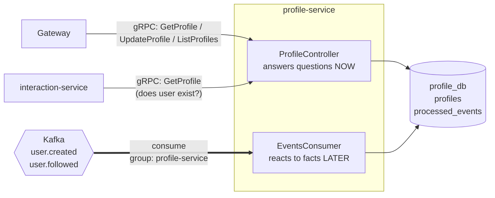
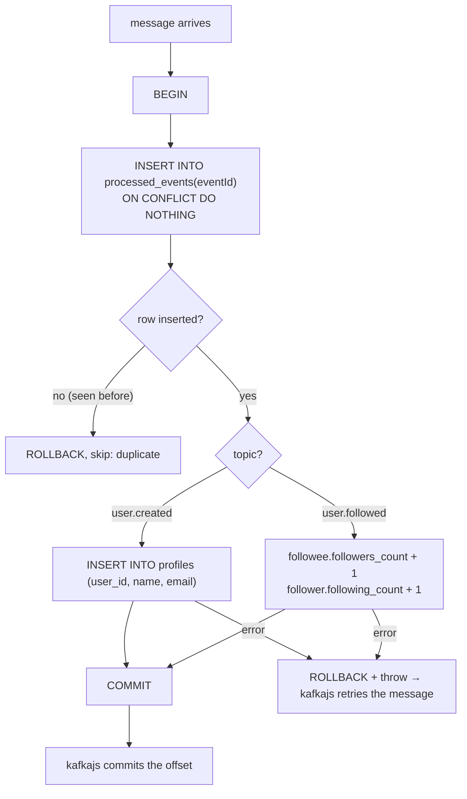
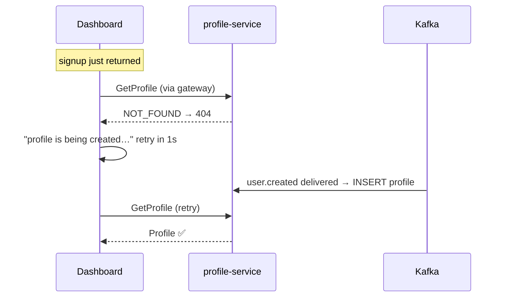

# profile-service

> Folder: `services/profile/src/` · gRPC on **:50052** · DB **profile_db** (Postgres :5434) · Kafka **consumer** of `user.created`, `user.followed`

## 1. What it is

Owns the **public profile**: name, email, bio, follower and following counts.
It's the service that demonstrates **both halves** of the system most clearly:



- **Door 1: gRPC server (sync).** Someone asks a question and waits for the answer.
- **Door 2: Kafka consumer (async).** Nobody calls it. It listens and updates its DB when other services announce something.

It never publishes events and never calls other services.

## 2. Database: `profile_db`

```sql
profiles         (user_id UUID PK, name, email, bio DEFAULT '', followers_count DEFAULT 0, following_count DEFAULT 0, created_at)
processed_events (event_id UUID PK, processed_at)
```
- `name` and `email` are a **copy** of auth's data, delivered by `user.created`. Profile can show users without calling auth. Auth stays the source of truth.
- `processed_events` remembers every Kafka event already applied, so a duplicate is ignored.

## 3. The gRPC methods

### `GetProfile(GetProfileRequest) → Profile`
**Input:** `{ user_id }` · **Does:** `SELECT … FROM profiles WHERE user_id = $1`
**Returns:** `{ user_id, name, email, bio, followers_count, following_count }`
**Errors:** `NOT_FOUND`, which can happen for about 1 s right after signup (event not consumed yet). The frontend retries.
**Called by:** gateway (`GET /profiles/me`) **and interaction-service** (to check a user exists before following).

### `UpdateProfile(UpdateProfileRequest) → Profile`
**Input:** `{ user_id, bio }` · bio > 280 chars → `INVALID_ARGUMENT`
**Does:** `UPDATE profiles SET bio … RETURNING …` (one query, returns the new row)
**Errors:** `INVALID_ARGUMENT`, `NOT_FOUND`
No event published: no other service cares about bios.

### `ListProfiles(ListProfilesRequest) → ListProfilesResponse`
**Input:** `{}` (empty message) · **Returns:** `{ profiles: Profile[] }` ordered by signup time.
No pagination (marked in code). Add `page_size`/`page_token` to the proto when needed.

## 4. The Kafka consumer (`events.consumer.ts`)

### Setup
```ts
kafka.consumer({ groupId: 'profile-service' })
consumer.subscribe({ topics: ['user.created', 'user.followed'], fromBeginning: true })
consumer.run({ eachMessage: … })
```
- **Started in the background with retries** (`start()` isn't awaited). The gRPC server answers even while Kafka is unreachable; the consumer joins when Kafka is ready.
- **groupId `profile-service`:** if you run 3 copies of profile-service, Kafka splits the topic's **3 partitions** between them, so each message is processed by **one** copy. Run 4 copies and one sits idle: max parallelism = number of partitions.
- **fromBeginning: true:** a brand-new group starts from the oldest retained message. That's how a new service can **rebuild its data from history**.

### Handling one message



**Why the dedupe table is in the same transaction:** "mark as processed" and "apply the change" must happen together. If they were separate, a crash between them would either lose the update or apply it twice.

**Why duplicates happen at all:** Kafka + our relay give **at-least-once** delivery. Exactly-once across Kafka *and* a database isn't free, so we make the consumer **idempotent**: applying the same event twice has the same effect as once.

Especially important for `user.followed`: `followers_count + 1` is **not** naturally idempotent. Without `processed_events`, a redelivery would count Riya's follow twice.

### Ordering
`user.followed` is keyed by `followeeId`, so all follows of Arjun land in the same partition, in order. Ordering is only guaranteed **within** a partition, never across a whole topic.

## 5. Eventual consistency, visible in the UI


Same thing after a follow: the follow is saved instantly, the counter updates ~1 s later.

## 6. Failure scenarios

| Situation | Result |
|---|---|
| profile-service down during signups | Signups succeed. Events wait in Kafka. On restart the consumer continues from its last committed offset and creates the missing profiles |
| profile-service down, user opens dashboard | 503 (sync path needs it alive) |
| profile-service down, user clicks Follow | 503 (interaction can't verify the user) |
| Same event delivered twice | Second one skipped by `processed_events` |
| DB error while handling an event | Transaction rolled back, offset **not** committed, Kafka redelivers |

## 7. Files
| File | What |
|---|---|
| `main.ts` | starts gRPC server on 50052 with `profile.proto` |
| `app.module.ts` | controller + Db + EventsConsumer |
| `profile.controller.ts` | `GetProfile`, `UpdateProfile`, `ListProfiles` |
| `events.consumer.ts` | Kafka consumer, idempotent handlers |
| `db.ts` | `profiles` + `processed_events` tables |
