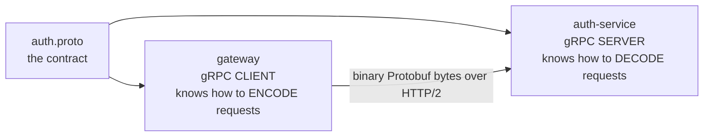

# proto/: The Contracts

> Files: `proto/auth.proto`, `proto/profile.proto`, `proto/interaction.proto`

## 1. What is a `.proto` file?

It's a **contract** written in Protocol Buffers' schema language. It says exactly:
- which **services** exist,
- which **methods (rpc)** each one has,
- what **message** goes in and what comes out, field by field, with types.

Both sides (client and server) load the **same file**. If the gateway sends something the file doesn't describe, it simply can't be encoded. Compare REST, where the contract is usually "whatever the README says".



## 2. Reading one, line by line

```proto
syntax = "proto3";          // version of the Protobuf language
package auth;               // namespace, used in code as package: 'auth'

service AuthService {                                  // a "class" of remote methods
  rpc SignUp (SignUpRequest) returns (AuthResponse);   // a remote method: input → output
  rpc Login (LoginRequest) returns (AuthResponse);
  rpc ValidateToken (ValidateTokenRequest) returns (ValidateTokenResponse);
}

message SignUpRequest {     // a data shape (like a TS interface)
  string name = 1;          // type, name, FIELD NUMBER
  string email = 2;
  string password = 3;
}
```

### The field numbers (`= 1`, `= 2`) are the important part
On the wire, Protobuf doesn't send the field **name** `"email"`. It sends the **number** `2` plus the value. That's why it's small and fast.

```
JSON  (62 bytes):  {"name":"Riya","email":"riya@mail.com","password":"secret123"}
Proto (32 bytes):  [tag 1][len 4]Riya [tag 2][len 13]riya@mail.com [tag 3][len 9]secret123
```

Rules that follow from this (common interview question: *"how do you evolve a proto safely?"*):
- ✅ **Add** new fields with **new numbers**. Old clients just ignore them (backward compatible).
- ❌ **Never change** a field's number or type.
- ❌ **Never reuse** a deleted field's number. Mark it `reserved 4;`.
- In proto3 every field is optional. A missing field reads as its default (`""`, `0`, `false`, `[]`).

**Real example in this repo:** `idempotency_key = 4` was added to `SignUpRequest` *after* the first version. A client that never sends it still works; auth sees `""` and simply skips the idempotency check. See [idempotency-and-backpressure.md](idempotency-and-backpressure.md).

### Types used here
| Proto | TypeScript |
|---|---|
| `string` | `string` |
| `bool` | `boolean` |
| `int32` | `number` |
| `repeated X` | `X[]` |
| `message Foo {}` (empty) | `{}` (still needed: every rpc takes exactly one message) |

## 3. Our three contracts

### auth.proto (server: auth-service :50051, client: gateway)
| rpc | Request | Response |
|---|---|---|
| `SignUp` | `name, email, password, idempotency_key` | `AuthResponse { user_id, token }` |
| `Login` | `email, password` | `AuthResponse { user_id, token }` |
| `ValidateToken` | `token` | `{ valid, user_id, email }` |

### profile.proto (server: profile-service :50052, clients: gateway, interaction-service)
| rpc | Request | Response |
|---|---|---|
| `GetProfile` | `user_id` | `Profile` |
| `UpdateProfile` | `user_id, bio` | `Profile` |
| `ListProfiles` | `{}` | `{ repeated Profile profiles }` |

`Profile = { user_id, name, email, bio, followers_count, following_count }`

### interaction.proto (server: interaction-service :50053, client: gateway)
| rpc | Request | Response |
|---|---|---|
| `Follow` | `follower_id, followee_id` | `{ success, message }` |
| `GetFollowing` | `user_id` | `{ repeated string followee_ids }` |

## 4. How NestJS uses these files

We use **dynamic loading** (`@grpc/proto-loader`): the `.proto` is read **at startup**, no code generation step.

**Server side** (e.g. `services/auth/src/main.ts`):
```ts
NestFactory.createMicroservice(AppModule, {
  transport: Transport.GRPC,
  options: { package: 'auth', protoPath: '.../proto/auth.proto', url: '0.0.0.0:50051' },
});
```
and each method is bound with a decorator:
```ts
@GrpcMethod('AuthService', 'SignUp')   // service name + rpc name, exactly as in the .proto
async signUp(data) { ... return { userId, token }; }
```

**Client side** (e.g. `gateway/src/grpc-clients.ts`):
```ts
ClientsModule.register([{ name: 'AUTH_PACKAGE', transport: Transport.GRPC,
  options: { package: 'auth', protoPath: '.../proto/auth.proto', url: 'localhost:50051' } }]);
// later
const auth = client.getService<AuthService>('AuthService');
auth.signUp({ name, email, password });   // returns an RxJS Observable
```

### snake_case vs camelCase
The proto says `user_id`. TypeScript code uses `userId`. proto-loader converts names to camelCase by default (`keepCase: false`). Same field, two spellings.

### `loader: { defaults: true }`
Protobuf doesn't send default values (`0`, `false`, `""`). Without this option, a profile with 0 followers would arrive with `followersCount` **missing** (undefined). With it, you get `0`.

### Static codegen (the alternative)
Bigger teams run `protoc` / `buf` with `ts-proto` to **generate** TypeScript interfaces from the `.proto`. We wrote them by hand in `grpc-clients.ts` to keep the project small. Mention that you know the trade-off: generated types can't drift from the contract.

## 5. Why share one `proto/` folder?

Server and client must agree on the contract. In a monorepo the simplest way is one shared folder. In multi-repo setups teams publish protos to a **schema registry / buf registry** or a shared package.

## 6. The 4 kinds of gRPC methods (we only use unary)

```proto
rpc GetProfile (Req) returns (Res);                  // unary: 1 → 1 (ours)
rpc WatchFeed (Req) returns (stream Post);           // server streaming: 1 → many
rpc UploadChunks (stream Chunk) returns (Res);       // client streaming: many → 1
rpc Chat (stream Msg) returns (stream Msg);          // bidirectional streaming
```
Streaming exists because HTTP/2 keeps a stream open in both directions. REST can't do this natively.
